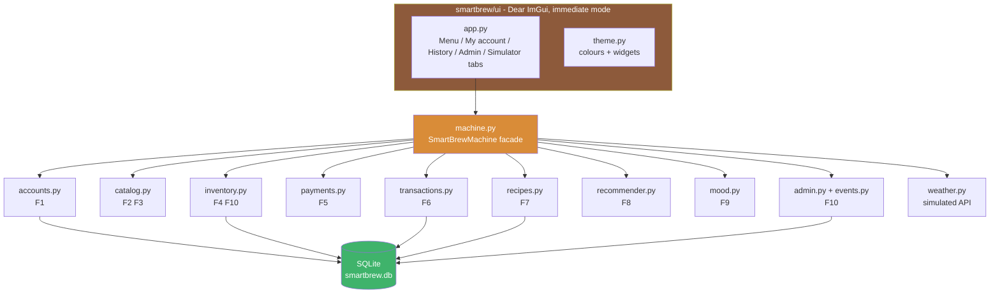

# SmartBrew AI – interactive coffee machine prototype

Lab Assignment 3 – Software Engineering with LLMs · Group 20 · Mälardalen University

SmartBrew AI is a touchscreen coffee machine that personalises drinks from the time of day, the
weather, the user's history and (simulated) camera mood detection, and takes card, wallet and
prepaid employee-card payments. This repository contains:

| Part | Where |
|---|---|
| Task A – LLM requirements, user stories, backlog, prompts, comparison with Lab 2 | [`docs/task_a/`](docs/task_a/) |
| Task B – the 10 implemented features and the LLM conversation | [`docs/task_b/`](docs/task_b/), source in [`smartbrew/`](smartbrew/) |
| Task C – this README, commented code, tests | here, [`tests/`](tests/) |

LLM used for all tasks: **Claude Opus 5.5** (`claude-opus-5-5`, Anthropic) via claude.ai.

 -orange) 

## 1 System overview

The GUI is written in **immediate mode** with Dear ImGui (Python bindings from `imgui-bundle`):
every frame the screen is redrawn from the current state, and widgets return their new values
directly. All logic lives in a GUI-free core, so it is fully unit-tested.

**Why Dear ImGui?** I chose Dear ImGui because it is the UI framework I am most familiar with,
coming from a C++ background. The `imgui-bundle` Python bindings keep the same API as the C++
library, so I could build the touchscreen the same way I would in C++.



The 10 features (details in [`docs/task_b/feature_selection.md`](docs/task_b/feature_selection.md)):

| # | Feature |
|---|---|
| F1 | Create account, log in with e-mail/password **or NFC/employee-card tap**, preference profile |
| F2 | Browse drink categories with nutrition information |
| F3 | Real-time customisation (milk, strength, temperature, syrup, extra shot) with live price/nutrition |
| F4 | Drinks with depleted ingredients are greyed out; alternative milk suggested |
| F5 | Payments: EMV/contactless card, Apple Pay, Google Pay, prepaid employee card; decline + retry; offline fallback |
| F6 | Every completed transaction recorded with all customisation parameters |
| F7 | Save, rename, edit, delete recipes; one-touch ordering |
| F8 | Recommendations from time, weather and history; menu reordered, top 3 highlighted with reasons |
| F9 | Camera mood detection (simulated camera) processed only in memory; tired → extra shot |
| F10 | Secure admin mode (PIN, NFC master card, physical key, lockout), refills, bin alerts/halt, error dashboard + event log |

## 2 Environment and prerequisites

| Requirement | Version | Notes |
|---|---|---|
| Python | **3.10 – 3.13** (tested logic on 3.13) | 64-bit. Get it from python.org. |
| imgui-bundle | ≥ 1.6 | Dear ImGui + GLFW + OpenGL bindings; pre-built wheels for Windows, macOS and Linux |
| NumPy | ≥ 1.24 | Used by the simulated camera / mood detector |
| SQLite | built into Python | No server needed |
| OS | Windows 10/11, macOS 12+, or Linux with OpenGL 3.3 | Primary target: Windows |

All Python dependencies are pinned in [`requirements.txt`](requirements.txt). Tests use only the
standard library (`unittest`) and NumPy — no window or GPU is needed to run them.

## 3 Build and run

### Windows (PowerShell)

```powershell
git clone <repository-url> smartbrew-ai
cd smartbrew-ai
py -3.12 -m venv .venv
.\.venv\Scripts\Activate.ps1
python -m pip install --upgrade pip
pip install -r requirements.txt
python main.py
```

### macOS / Linux

```bash
git clone <repository-url> smartbrew-ai
cd smartbrew-ai
python3 -m venv .venv
source .venv/bin/activate
python -m pip install --upgrade pip
pip install -r requirements.txt
python main.py
```

Options: `python main.py --reset` starts from fresh demo data, `python main.py --db other.db`
uses another database file. The database `smartbrew.db` is created and seeded automatically.

### Run the tests

```bash
python -m unittest discover -s tests -v
```

Expected: `Ran 39 tests … OK` — 33 feature tests (one test class per feature F1–F10) and 6
headless GUI journeys that drive the real UI code through a fake ImGui module.

### Demo credentials (seeded)

| What | Value |
|---|---|
| User | `demo@smartbrew.local` / `demo1234` (prefers oat milk, strength 4) |
| User's NFC / prepaid card | `NFC-EMP-1001` (balance 150 SEK) |
| Technician PIN | `1234` |
| NFC master card | `NFC-MASTER-0001` |
| Test cards | `4242 4242 4242 4242` approved · `4000 0000 0000 0002` declined · `4000 0000 0000 9995` insufficient funds |

## 4 Execution guide – demonstrating the 10 features

The window has five tabs: **Menu**, **My account**, **History**, **Admin** and **Simulator**.
The Simulator stands in for hardware and external services (clock, weather, network, sensors, faults).
Tip: start with `python main.py --reset` for a clean demo.

### F1 – Accounts, NFC login, preferences
1. **My account** → *Create an account*: enter a name, e-mail, password (≥ 6 chars) and optionally a card ID such as `NFC-EMP-2002` → **Create account**. The top bar shows "Hello, <name>".
2. **Log out** (top bar). In *Or tap your NFC / employee card* type the card ID → **Tap card on reader** → logged in again.
3. Try a duplicate e-mail or a short password → a red error explains why.
4. Change *Default milk* / *Default strength*; open any milk drink on the **Menu** → it starts with your defaults.

### F2 – Browse with nutrition
1. **Menu** → click the category buttons on the left (Espresso, Milk coffee, Chocolate, Iced).
2. Click a drink card → the right panel shows its description and a nutrition table (calories, sugar, fat, caffeine).

### F3 – Live customisation
1. Select **Latte**. Change *Milk* to Almond, move *Syrup shots* to 2, tick *Extra espresso shot*.
2. Price and the nutrition table update instantly (e.g. almond lowers calories, syrup raises sugar).

### F4 – Depleted ingredients
1. **Simulator** → *Ingredient sensors* → drag **Coffee beans** below 60 g → **Menu**: all coffee drinks are grey and say UNAVAILABLE (hover for the reason); Hot Chocolate stays available.
2. Drag **Whole milk** to 0 → open a Latte: another milk is pre-selected and "Out of stock: Whole milk" is shown.
3. **Drain all milks below threshold** → all milk drinks are greyed out.
4. Restore with **Admin → Refill all** (see F10).

### F5 – Payments
1. Select a drink → **Order & pay**. Choose **Card** → click the *Always declined* test card → **Pay** → "Card declined by issuer". **Try another method**.
2. Choose **Apple Pay** or **Google Pay** → **Pay** → approved. Untick *Customer approves on phone* to see a cancelled wallet payment.
3. Choose **Prepaid card**, enter `NFC-EMP-1001` → **Pay** → approved, new balance shown.
4. Offline: **Simulator** → untick *Network / external services online*. Wallets are now refused; a card payment ≤ 100 SEK is "Approved offline". Tick the network again → the toast says the offline payment was uploaded; **History** shows it as *synced*.

### F6 – Transaction recording
1. After any successful payment the right panel shows the stored record (id, time, options, reference).
2. **History** (log in as the demo user) lists every order with milk, strength/temperature, syrup, price and method. Guest orders are visible to technicians: enter admin mode and tick *Show all machine transactions*.

### F7 – Saved recipes and one-touch ordering
1. Log in as the demo user. On **Menu** customise a drink, type a name (e.g. `Morning boost`) under *Save as recipe* → **Save**.
2. **My account** → *My recipes*: **1-Touch** orders it immediately with the linked prepaid card; **Open** loads it in the Menu; **Edit** renames/changes it; **Delete** removes it. Duplicate names are refused.

### F8 – Recommendations
1. **Simulator** → tick *Override time of day*, set **Hour 08:00**, temperature **0 °C**, condition **Snowy** → **Menu**: high-caffeine hot drinks rise to the top with the gold "* TOP PICK *" label. Hover a card to see its score and reasons; the left panel explains the context.
2. Set **14:00** and **28 °C Sunny** → iced drinks move to the top.
3. Set **21:00** → Hot Chocolate (low caffeine) leads.
4. Log in and order the same drink a few times → it climbs because of "You ordered it Nx".
5. Turn the network off → "Weather API offline": ranking continues with time and history only.

### F9 – Mood detection (in memory)
1. **Menu** → *Mood scan (camera)*: pick **Tired** → **Scan my mood** → "Detected: Tired"; caffeine-rich drinks move up and opening a coffee drink pre-ticks *Extra espresso shot*.
2. Try **Happy** (sweet/iced drinks) and **Stressed** (low caffeine).
3. The privacy panel shows *Images stored/sent: 0* and *Last frame wiped: yes* — the frame exists only in RAM and is zero-filled right after analysis (verified by `F9MoodDetection` tests).

### F10 – Admin mode
1. **Admin** → enter a wrong PIN three times → locked for 30 s. Wait, then use the keypad `1 2 3 4` → **Enter PIN** (or **Use demo master card** → **Tap card**, or **Turn service key**).
2. Dashboard: ingredient bars (green/amber/red) with **Refill** and **Refill all**; waste bins with **Empty**.
3. **Simulator** → *Bin sensors*: drag *Coffee grounds* above 80 % → warning in the event log; to 100 % → top bar "OUT OF SERVICE" and ordering stops. **Admin → Empty** restores service.
4. **Simulator** → *Hardware faults* → **Trigger: Grinder Jammed** → coffee drinks are blocked and the fault appears under *Active faults* and in the event log → **Resolve**.
5. Filter the event log by level (INFO / WARNING / ERROR).

## 5 Project structure

```
smartbrew-ai/
├── main.py                  entry point (python main.py [--reset] [--db FILE])
├── requirements.txt         pinned dependencies
├── smartbrew/
│   ├── machine.py           SmartBrewMachine facade used by GUI and tests
│   ├── db.py                SQLite schema + demo seed data
│   ├── security.py          salted PBKDF2 hashing
│   ├── accounts.py          F1      catalog.py   F2, F3
│   ├── inventory.py         F4, F10 payments.py  F5
│   ├── transactions.py      F6      recipes.py   F7
│   ├── recommender.py       F8      mood.py      F9
│   ├── admin.py, events.py  F10     weather.py   simulated weather API
│   └── ui/
│       ├── app.py           Dear ImGui screens (5 tabs)
│       └── theme.py         colours, style, small widgets
├── tests/
│   ├── test_features.py     33 tests, one class per feature
│   ├── test_ui_smoke.py     6 headless GUI journeys
│   └── fake_imgui.py        fake imgui module for headless tests
└── docs/
    ├── task_a/              prompts, LLM artifacts, comparison with Lab 2
    └── task_b/              feature selection, LLM conversation
```

Every function and method has a docstring with its purpose, input parameters (Args) and return
value (Returns).

## 6 Troubleshooting

| Problem | Fix |
|---|---|
| `pip install imgui-bundle` tries to compile from source | Use a Python version that has pre-built wheels (3.11 or 3.12 are safest) and a 64-bit interpreter. |
| Linux: window does not open / GLX error | Install OpenGL drivers (`sudo apt install libgl1 libglfw3`) or run on the host instead of WSL/remote SSH. |
| Text looks too small/large | DPI scaling is automatic; the theme also sets a 1.15 font scale in `smartbrew/ui/theme.py`. |
| Want a clean demo | `python main.py --reset` |

## 7 Limitations

Hardware (camera, sensors, card reader, network) is simulated. No real payment provider is
contacted; card numbers are validated with Luhn and test numbers only, and are never stored.
Receipts (QR/e-mail) and the optional local LLM agent are specified in Task A but not part of
the 10 implemented features.
