# Task A – Prompt strategy and transcript (appendix)

## Model used

| Task | Model | Version / ID | Interface | Date |
|---|---|---|---|---|
| A – requirements elicitation | Claude Opus 5.5 (Anthropic) | `claude-opus-5-5` | claude.ai (chat with file and code tools) | 25–26 Oct 2026 |
| B – code generation | Claude Opus 5.5 (Anthropic) | `claude-opus-5-5` | same session | 26 Oct 2026 |
| C – documentation | Claude Opus 5.5 (Anthropic) | `claude-opus-5-5` | same session | 26 Oct 2026 |

No other LLM was used. The full chat can be exported from claude.ai (Share → copy link) and
attached to the submission; the main prompts and key responses are reproduced below.

## Prompt strategy

We used a **staged, structured prompting strategy** instead of one big prompt:

```mermaid
flowchart LR
    P0[P0 Role + context<br/>system description pasted] --> P1[P1 Stakeholders<br/>+ open questions]
    P1 --> P2[P2 Functional reqs<br/>Lab 2 table format]
    P2 --> P3[P3 Non-functional reqs<br/>with fit criteria]
    P3 --> P4[P4 User stories<br/>+ acceptance criteria]
    P4 --> P5[P5 Product backlog<br/>Imp / Est / How to demo]
    P5 --> P6[P6 Source tagging<br/>SD / SD-i / NEW]
    style P0 fill:#8d5a3b,color:#fff
    style P1 fill:#d98c38,color:#fff
    style P2 fill:#4c8fea,color:#fff
    style P3 fill:#4c8fea,color:#fff
    style P4 fill:#3fb36b,color:#fff
    style P5 fill:#9e6be0,color:#fff
    style P6 fill:#e06b9e,color:#fff
```

Techniques and why we chose them:

| Technique | Where | Reason |
|---|---|---|
| Role prompting ("act as a requirements engineer") | P0 | Pushes the model towards RE vocabulary and completeness. |
| Grounding: full system description pasted verbatim | P0 | Reduces hallucinated features; every later prompt refers back to it. |
| Output template = our Lab 2 table columns | P2, P4, P5 | Makes the LLM artifacts directly comparable with Assignment 2. |
| Decomposition into one artifact per prompt | P2–P5 | Keeps each response focused on one artifact, so it can be checked before the next step builds on it. |
| Chain dependency (stories reference FR ids, backlog references stories) | P4, P5 | Gives traceability we can check. |
| Explicit request for measurable fit criteria | P3 | Avoids vague NFRs such as "fast" or "secure". |
| Provenance tagging (SD / SD-i / NEW) | P6 | Makes scope creep visible so we can accept or reject each NEW item. |

**Independence note (threat to validity).** The elicitation prompts contained only the system
description, not our Lab 2 document. However, the Lab 2 PDF was attached earlier in the same chat
for Task C/comparison purposes, so we cannot fully exclude that it influenced wording (e.g. the
table layout, which we asked for explicitly anyway). We judge the effect small because the LLM
output differs substantially in structure and content (see the comparison).

## Main prompts and key responses

### P0 – Role and context

> **Prompt:** You are an experienced requirements engineer. Below is the system description for
> "SmartBrew AI", an interactive IoT/AI coffee machine for offices, lounges and homes. We will
> elicit requirements in several steps. Base everything on this description; when you add
> something that is not in it, say so explicitly.
> *[full system description pasted]*

> **Key response (summary):** The model restated the scope in five areas (accounts & personalisation,
> menu & customisation, payment, AI features — recommendations, mood, optional LLM — and
> maintenance/resilience) and confirmed it would mark additions.

### P1 – Stakeholders and open questions

> **Prompt:** List the stakeholders and user roles. Then list the questions you would ask the
> stakeholders before writing requirements, and the assumption you will make for each if we
> cannot answer.

> **Key response (excerpt):**
>
> *Roles:* guest customer, registered user, privacy-conscious customer, technician, operator (owner).
> Secondary stakeholders: payment processors, weather API provider, data-protection officer.
>
> | Open question | Assumption made |
> |---|---|
> | Is mood detection opt-in or always on? | Opt-in per session, camera indicator visible. |
> | May mood labels be stored? | No — only used for the current suggestion. |
> | Offline card limit? | A floor limit applies; above it cards are refused offline. |
> | How long are event logs kept? | 90 days. |
> | Is the LLM module always present? | Optional; the system must work fully without it. |
> | What counts as "depleted"? | Level at or below a per-ingredient minimum threshold. |

### P2 – Functional requirements

> **Prompt:** Write the functional requirements as a table with columns ID, Description,
> Inputs, Outputs, Precondition. Use "The system shall …". Group them by area. After the
> table, list separately any extra features you think stakeholders might want.

> **Key response:** FR1–FR33 and the extra ideas X1–X8 →
> [`02_llm_requirements.md`](02_llm_requirements.md) §1.

### P3 – Non-functional requirements

> **Prompt:** Now write non-functional requirements (privacy, security, performance,
> availability, usability, accessibility, maintainability, safety…). Each must have a
> measurable fit criterion saying how we would verify it.

> **Key response:** NFR1–NFR16 → [`02_llm_requirements.md`](02_llm_requirements.md) §2.

### P4 – User stories

> **Prompt:** Write user stories in the form "As a … I want … so that …" in a table with columns
> ID, Who, What, Why. Add short Given/When/Then acceptance criteria and the FR ids each story
> realises. Cover every functional requirement.

> **Key response:** LUS1–LUS27 → [`03_llm_user_stories.md`](03_llm_user_stories.md).

### P5 – Product backlog

> **Prompt:** Create the initial product backlog with columns ID, Name, Importance (higher =
> more important, max 200), Estimate in story points (≈ ideal person-days), Description,
> How to demo, Stories. Order by importance. Give the total estimate.

> **Key response:** B1–B21, 126 story points →
> [`04_llm_product_backlog.md`](04_llm_product_backlog.md).

### P6 – Provenance tagging

> **Prompt:** For every functional requirement, mark whether it is stated in the description
> (SD), implied by it (SD-i), or your own addition (NEW).

> **Key response:** the *Source* column in [`02_llm_requirements.md`](02_llm_requirements.md).
> 12 of 33 FRs were tagged NEW (8) or partly NEW (4), plus the 8 extra ideas X1–X8.

## Human review step

After P6 we compared every artifact with our Lab 2 submission line by line and decided for each
NEW item whether to accept or reject it. Decisions and justifications are in
[`05_comparison_with_lab2.md`](05_comparison_with_lab2.md).
