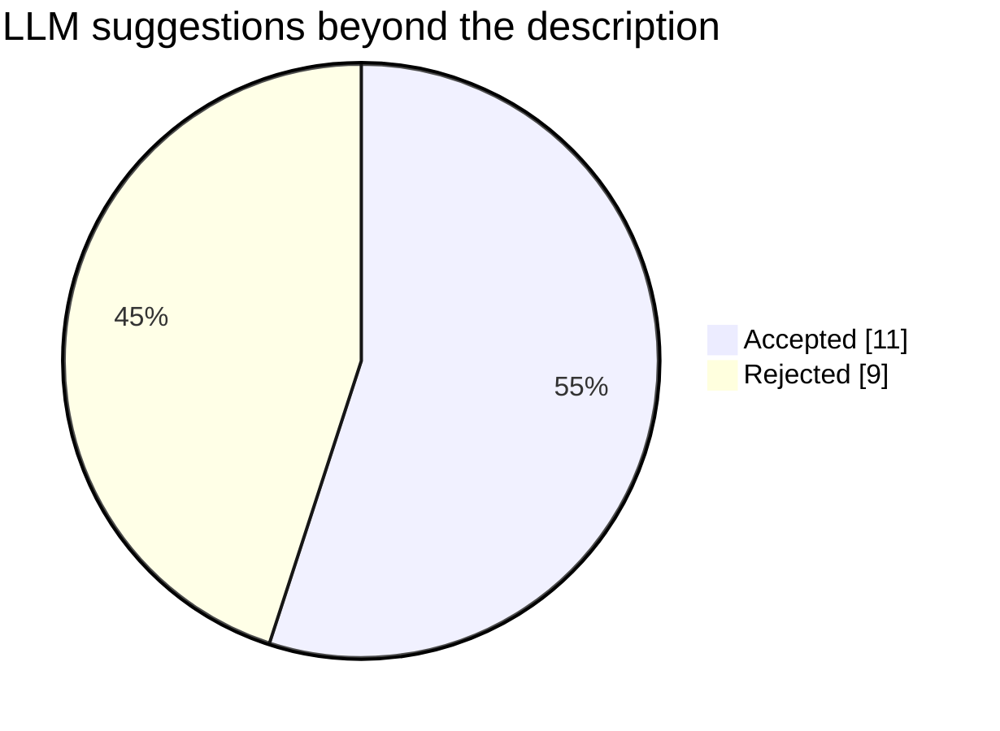
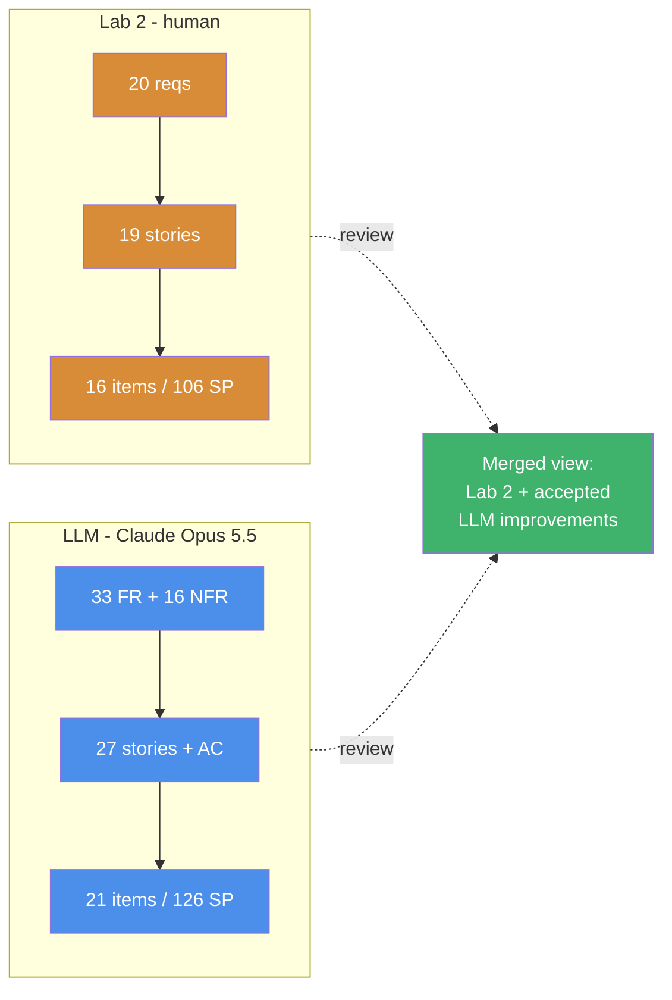

# Task A – Comparison: LLM artifacts vs. our Lab 2 (human) artifacts

Lab 2 = *G20Lab2.pdf* (Group 20, human-elicited). LLM = Claude Opus 5.5 output in files 02–04.
Legend in diff blocks: `-` red = Lab 2 wording, `+` green = LLM wording.

## 1 At a glance

| Artifact | Lab 2 (human) | LLM | Change |
|---|---|---|---|
| Roles | 4 | 5 (+ privacy-conscious customer) | +1 |
| Functional requirements | 20 (R1–R20) | 33 (FR1–FR33) + 8 extra ideas | +13 (+8) |
| Non-functional requirements | 0 (privacy and fallback written as functional) | 16, each with a fit criterion | +16 |
| User stories | 19 (US1–US19) | 27 (LUS1–LUS27) with acceptance criteria | +8 |
| Backlog items | 16 | 21 | +5 |
| Total estimate | 106 SP | 126 SP | +20 SP (+19 %) |

What happened to the 20 suggestions the LLM itself tagged as going beyond the description (12 NEW / partly-NEW functional requirements + 8 extra ideas X1–X8). Implied additions (FR30, FR33, history view) and the NFRs are discussed separately in §7–§8:





## 2 Requirements – side by side

| Lab 2 | LLM | Type of change | Verdict |
|---|---|---|---|
| R1 Create account | FR1 | Same | – |
| R2 Log in by credentials or card | FR2 + FR3 | Split into two testable requirements | Improvement |
| R3 Preference profile | FR5 | Extended with dietary flags | Improvement (accepted) |
| R4 Categories + nutrition | FR7 + FR8 | Split; allergens added | Improvement (accepted) |
| R5 Real-time customisation | FR9 | Adds response time < 200 ms | Improvement |
| R6 Saved recipes | FR13 | Rename/delete made explicit | Same intent |
| R7 Record transactions | FR14 | **Precondition weaker, anonymous case dropped** | **Worse** (see M1, M2) |
| R8 Recommendation score | FR16 | Same | – |
| R9 Mood detection | FR19 + FR20 + FR21 | Adds opt-in and camera indicator | Improvement (accepted) |
| R10 In-memory face processing | NFR1 | Moved to NFR with a measurable fit criterion | Improvement |
| R11 Reorder/highlight menu | FR17 + FR18 | Adds "why recommended" | Improvement (accepted) |
| R12 Block depleted drinks | FR11 + FR12 | Adds reason text and alternatives | Improvement (accepted) |
| R13 Payment methods | FR22 + FR23 | Adds decline-and-retry | Improvement (accepted) |
| R14 Receipt QR / e-mail | FR24 | Same | – |
| R15 LLM free-text ordering | FR25 | Adds confirmation before brewing | Improvement (accepted) |
| R16 Admin access | FR26 | Adds lockout after 3 failures | Improvement (accepted) |
| R17 Refills | FR27 | Same | – |
| R18 Bin monitoring | FR28 | Adds an explicit 80 % alert level | Improvement (value to validate) |
| R19 Errors + event log | FR29 + FR30 | Adds remote upload of the log | Improvement (accepted) |
| R20 Offline fallback | FR32 + FR33 | Adds settlement after reconnect | Improvement (accepted) |
| – | FR4, FR6, FR10, FR31 | New | see §7 |

### Selected diffs

```diff
  R7 / FR14 - Record transactions
- Inputs:       Drink, customization, price, payment method, user ID (if logged in), timestamp
+ Inputs:       Order + payment result
- Precondition: Payment is approved and the drink is dispensed
+ Precondition: Payment approved
```

```diff
  R10 -> NFR1 - Privacy of facial images
- R10 (functional): Process facial images only in memory and discard them immediately.
-     Inputs: Facial image   Outputs: Mood label only   Precondition: An image has been captured
+ NFR1 (privacy): Facial images are processed only in memory and discarded immediately after
+     inference; never stored locally or transmitted.
+     Fit criterion: 0 image bytes written to disk or network; buffer zeroed <= 1 s after capture.
```

```diff
  R12 -> FR11 + FR12 - Depleted ingredients
  Prevent selection of drinks whose ingredients are depleted or below the minimum threshold
- Outputs: Unavailable drinks shown greyed out
+ Outputs: Drink greyed out with reason
+ FR12: suggest an available alternative (e.g. oat milk instead of dairy) instead of
+       blocking the whole drink
```

```diff
  R16 -> FR26 - Admin access
  Give access to admin mode only by physical key, NFC master card or technician PIN
+ and lock PIN entry for 30 s after 3 failed attempts
```

```diff
  R20 -> FR32 + FR33 - Network failure
  Fall back to manual ordering and offline card payment when the network or external services fail
+ FR33: When the network returns, upload stored offline payments for settlement
```

## 3 Non-functional requirements

Lab 2 had **no NFR section**. Two quality concerns (privacy R10, resilience R20) were written as
functional requirements and had no verification criterion. The LLM produced 16 NFRs, each with a
fit criterion. This is the single biggest improvement.

```diff
- (no non-functional requirements in Lab 2)
+ NFR1  Privacy        in-memory face processing, 0 bytes persisted
+ NFR2  Privacy        no mood labels stored
+ NFR3  Security       salted hashes for passwords, PINs, master card
+ NFR4  Security       lockout after 3 failed admin attempts
+ NFR5  Compliance     PCI DSS, no full card numbers stored
+ NFR6  Performance    200 ms touch response, < 1 s re-ranking
+ NFR7  Performance    mood inference < 2 s
+ NFR8  Availability   fallback within 5 s, no lost paid transaction
+ NFR9  Reliability    transaction durable before success screen
+ NFR10 Usability      default drink in <= 3 taps
+ NFR11 Accessibility  44 px targets, WCAG AA contrast
+ NFR12 Modularity     LLM module removable without side effects
+ NFR13 Privacy        LLM runs locally, no outbound text
+ NFR14 Auditability   90-day timestamped event log
+ NFR15 Safety         halt on overflow / heater / grinder fault
+ NFR16 Portability    embedded Linux + desktop
```

## 4 User stories

| Lab 2 | LLM | Comment |
|---|---|---|
| US1–US19, Who/What/Why only | LUS1–LUS27, Who/What/Why **+ acceptance criteria + FR link** | Acceptance criteria make stories testable; the FR link gives traceability. |
| US2 log in | LUS2 log in + LUS3 auto-logout | New security story (accepted). |
| US3 browse + nutrition | LUS6 browse + nutrition + allergens | Allergens accepted. |
| US9 face processed in memory | LUS17 opt-in + no storage, role "privacy-conscious customer" | Better: privacy told from the perspective of the person who cares. |
| US12 pay | LUS18 pay + LUS19 retry after decline | Accepted. |
| US19 offline (operator) | LUS27 offline + settlement (operator) | Accepted, but it bundles two goals. |
| – | LUS5 delete account, LUS8 cup size, LUS10 alternatives, LUS13 history, LUS15 explanation, LUS26 cleaning | New; see §7. |

```diff
- US8  As a customer I want the machine to suggest a drink based on my mood detected by the camera
-      so that I get a drink that fits how I feel right now.
+ LUS16 As a registered user I want the machine to read my mood and suggest a drink
+       so that it fits how I feel.
+       AC: Given I look tired and opted in, then an extra espresso shot is suggested.
```

```diff
- US5  As a registered user I want to save, name and edit my own recipes
-      so that I can order my favourite drink with one touch.
+ LUS11 As a registered user I want to save, rename, edit and delete my own recipes and order
+       them with one touch so that my favourite is one tap away.
+       AC: When I save "Morning boost", log out and in again and tap it, then the drink is
+       ordered with the same settings.
```

## 5 Product backlog

| Item | Lab 2 Imp / Est | LLM Imp / Est | Comment |
|---|---|---|---|
| Browse menu and order | 200 / 8 (incl. nutrition) | 200 / 8 (**without** nutrition) | Nutrition moved to B18 at importance 55 (see M6). |
| Payments | 190 / 13 | 195 / 13 | + decline/retry. |
| Block depleted ingredients | 180 / 3 | 180 / 5 | + alternatives, +2 SP. |
| Record transactions | 170 / 3 | 185 / 3 | Ranked higher. |
| Offline fallback | 165 / 8 | 170 / 8 | + settlement. |
| Admin access | 160 / 3 | 160 / 3 | + lockout. |
| Refills / bins / errors | 150, 145, 140 | 150, 145, 140 | Same. |
| Customise drink | 130 / 5 | 135 / 5 | Same. |
| Accounts and login | 120 / 8 | 130 / 8 | + auto-logout, preferences. |
| Saved recipes | 100 / 5 | 110 / 5 | Same. |
| Receipts | 90 / 3 | 85 / 3 | Same. |
| Recommendations | 80 / 8 | 100 / 8 | + explanation. |
| Mood suggestions (incl. privacy) | 50 / 13 | 60 / 13 **and** separate privacy item 175 / 3 | Privacy split out and ranked far above the feature it protects (M3). |
| LLM ordering | 20 / 13 | 20 / 13 | Same. |
| – | – | B15 history 2, B18 allergens+sizes 5, B19 deletion 3, B20 cleaning 5 | New. |

```diff
  Backlog totals
- 16 items, 106 story points
+ 21 items, 126 story points  (+5 items: B5 privacy split, B15, B18, B19, B20)
```

## 6 What the LLM improved

1. **NFRs with fit criteria** (none in Lab 2) — privacy, security, performance, safety become testable.
2. **Acceptance criteria and traceability** (story → FR, backlog → story) — not present in Lab 2.
3. **Split compound requirements** (R2 → FR2/FR3, R4 → FR7/FR8) so each one can be tested alone.
4. **Missing error paths:** declined payment and retry (FR23), admin lockout (FR26), settlement after offline mode (FR33).
5. **Privacy by design:** explicit opt-in and camera indicator (FR21), a dedicated privacy role, no stored mood labels (NFR2).
6. **Better UX around constraints:** suggest an alternative milk instead of blocking a whole drink (FR12), explain recommendations (FR18).
7. **Legal obligations we missed:** account/data deletion (GDPR, FR6), allergen information (FR8).
8. **Clarifying questions with explicit assumptions** (P1) — useful input for the next stakeholder meeting.

## 7 Missing, weaker or incorrect LLM output

| # | Finding | Effect | What we do |
|---|---|---|---|
| M1 | FR14 precondition is only "payment approved". Lab 2 R7 required "approved **and dispensed**". | A sale could be recorded although dispensing failed (e.g. grinder jam after payment). | Keep Lab 2 precondition. Prototype records only after dispensing. |
| M2 | FR14 no longer states that anonymous purchases are recorded with an empty user ID. | Guest sales could be dropped or forced to log in. | Keep Lab 2 input list; prototype stores `user_id = NULL` for guests. |
| M3 | Backlog ranks "camera privacy guarantee" (175) far above "mood suggestions" (60). | Dependency error: the guarantee protects a feature that would not exist for many sprints. | Merge back into one item, as in Lab 2 item 15. |
| M4 | Numbers in NFRs and acceptance criteria (200 ms, 2 s, 60 s, 80 %, 90 days, 44 px, 1 s) are **invented**, not from the description or stakeholders. | They look authoritative but are assumptions. | Accept as *proposed* values, mark "to be validated with stakeholders". |
| M5 | Scope creep: 21 items / 126 SP vs 16 / 106 SP. | Plans would be over-committed. | Reject out-of-scope items (§8); accepted additions are mostly small. |
| M6 | Nutrition information (in the description, and in Lab 2 item 1) was moved to B18 at importance 55, bundled with cup sizes. | A described requirement was demoted below optional ideas. | Keep nutrition in the core "browse" item. |
| M7 | Several LLM stories bundle multiple goals (LUS11: save + rename + edit + delete + one-touch; LUS27: offline + settlement). | Violates the "Small" in INVEST; harder to estimate. | Split when moving into sprint planning. |
| M8 | **Self-contradiction:** extra idea X2 (store mood history) contradicts the LLM's own NFR2 (no mood labels stored); X1 (face login) contradicts NFR1. | The LLM did not check its suggestions against its own requirements. | Reject X1 and X2. |
| M9 | **Missed by both** Lab 2 and the LLM: "delegate user interaction and customisation logic to the local LLM" is only covered as free-text ordering (R15 / FR25), not as an interaction mode. | Gap in both versions. | Add to the LLM module item when it is planned. |

## 8 Decisions on every LLM addition (with justification for rejections)

| ID | Suggestion | Decision | Justification |
|---|---|---|---|
| FR4 | Auto-logout after inactivity | ✅ Accept | Shared kiosk: prevents the next person ordering on someone else's account. |
| FR5 (part) | Dietary flags in profile | ✅ Accept (low priority) | Supports allergen/vegan filtering; small effort. |
| FR6 | Account and data deletion | ✅ Accept | Required by GDPR (right to erasure) in Sweden/EU. |
| FR8 (part) | Allergen information | ✅ Accept | Food information to consumers must include allergens; safety issue. |
| FR10 | Cup sizes S/M/L | ❌ **Reject** | Not in the description; multiplies recipe, pricing and inventory logic for no stated need. Can be raised with the stakeholder later. |
| FR12 | Alternative when an ingredient is depleted | ✅ Accept | Refines R12 without contradicting it; better experience. Implemented. |
| FR18 | Explain recommendations | ✅ Accept | Transparency increases trust in AI suggestions. Implemented. |
| FR21 | Opt-in and camera indicator | ✅ Accept | Needed for a lawful, transparent use of the camera. Implemented as an explicit "Scan my mood" action. |
| FR23 | Retry after decline | ✅ Accept | Normal payment flow; avoids losing the order. Implemented. |
| FR25 (part) | Confirm LLM proposal before brewing | ✅ Accept | LLM may misread "low dairy"; confirmation protects users with intolerances. |
| FR26 (part) | Admin lockout | ✅ Accept | Brute-force protection for a 4-digit PIN. Implemented. |
| FR30 | Remote upload of event log | ✅ Accept | The description says logs are "for remote diagnostics". |
| FR31 | Cleaning / descaling schedule | ❌ **Reject** | Not in the description; belongs to the machine's firmware/maintenance contract, adds 5 SP. |
| FR33 | Settle offline payments on reconnect | ✅ Accept | Lab 2 already demoed it (backlog item 5) but had no requirement for it. Implemented. |
| X1 | Face-recognition login | ❌ **Reject** | Conflicts with the description (images must be discarded immediately) and NFR1; needs stored biometric templates, special-category data under GDPR. |
| X2 | Store mood history | ❌ **Reject** | Contradicts NFR2; emotional profiling of employees is intrusive and not needed for the stated goal. |
| X3 | Loyalty programme | ❌ **Reject** | Business feature outside the described system; no stakeholder asked for it. |
| X4 | Mobile pre-order app | ❌ **Reject** | A separate product with its own system boundary, backend and security model. |
| X5 | Voice ordering | ❌ **Reject** | Needs new hardware (microphone) and raises new privacy issues; natural-language ordering is already covered by the text LLM module. |
| X6 | Dynamic pricing | ❌ **Reject** | Not requested; perceived as unfair in an office; combined with mood data it could become manipulative. |
| X7 | Automatic supply re-ordering | ❌ **Reject** | Requires supplier integration and purchasing rules outside the scope; technicians handle refills. |
| X8 | Multi-language UI | ✅ Accept (low priority) | Reasonable for Swedish offices with international staff; no new data. |
| NFR1–NFR16 | All NFRs | ✅ Accept | With the caveat from M4: numeric values are proposals to validate. |
| LUS13 / B15 | Order history view | ✅ Accept | Implied by recording history; 2 SP. Implemented. |

Of the 20 LLM-tagged additions: **11 accepted, 9 rejected** (FR10, FR31, X1–X7). In addition we accepted the implied additions FR30, FR33 and the history view, accepted all NFRs (values to validate), and reverted two backlog changes (privacy split B5 and the nutrition demotion in B18, see M3/M6).

## 9 Conclusion

The LLM was strongest at **completeness and structure**: NFRs, acceptance criteria, error paths,
legal obligations and traceability were all better than in our Lab 2 version. It was weakest at
**judgement**: it invented precise numbers, ranked a dependent item above the feature it depends
on, demoted a described requirement, contradicted its own privacy requirements in its "extra
ideas" and inflated scope by 19 %. The human review step was therefore essential — the useful
result is the merge of Lab 2 with the accepted LLM improvements, not the raw LLM output.
