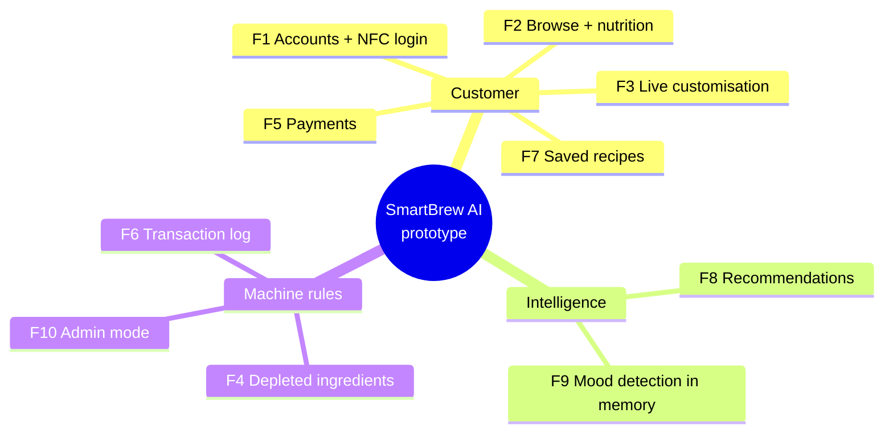

# Task B – The 10 implemented features

Selected from the accepted requirements of Task A. Each is non-trivial: it combines persistent
state, business rules and a GUI flow, and each has its own automated test class in
`tests/test_features.py` plus GUI journeys in `tests/test_ui_smoke.py`.

| # | Feature | Requirements (Task A / Lab 2) | Why it is non-trivial | Main code | Tests |
|---|---|---|---|---|---|
| F1 | Account creation, login by credentials **or NFC/card tap**, preference profile | FR1–FR3, FR5 / R1–R3 | Validation, unique e-mail/card, salted PBKDF2 hashing, profile drives drink defaults | `accounts.py`, `machine.py` | `F1Accounts` |
| F2 | Browse categories with nutrition information | FR7, FR8 / R4 | Category filter + nutrition recomputed per milk type | `catalog.py` | `F2BrowseAndNutrition` |
| F3 | Real-time customisation (milk, strength, temperature, syrup, extra shot) | FR9 / R5 | Live price and nutrition every frame; per-drink clamping (iced, no milk) | `catalog.py`, `ui/app.py` | `F3Customization` |
| F4 | Block drinks with depleted ingredients, suggest alternative milk | FR11, FR12 / R12 | Per-ingredient thresholds, recipe-specific needs, alternative milk logic | `inventory.py` | `F4DepletedIngredients` |
| F5 | Payment: EMV card, Apple Pay, Google Pay, prepaid employee card, decline + retry, offline fallback | FR22, FR23, FR32, FR33 / R13, R20 | Luhn check, test-card outcomes, prepaid balance, offline store-and-forward with sync | `payments.py` | `F5Payments` |
| F6 | Automatic transaction recording with all customisation parameters | FR14, FR15 / R7 | Recorded only after payment and dispensing; guest = `NULL` user; stock and bins updated | `transactions.py`, `inventory.consume` | `F6TransactionRecording` |
| F7 | Save, rename, edit, delete recipes; one-touch ordering | FR13 / R6 | Unique names per user (case-insensitive), ownership checks, 1-Touch pays with linked prepaid card | `recipes.py` | `F7SavedRecipes` |
| F8 | Recommendations from time of day, weather and history; menu reordered, top 3 highlighted, reasons shown | FR16–FR18 / R8, R11 | Four-signal scoring with explanations; weather outage handled | `recommender.py` | `F8Recommendations` |
| F9 | Camera mood detection (simulated) processed only in memory, mood-adapted suggestions | FR19–FR21, NFR1 / R9, R10 | Synthetic frame → feature extraction → classification → buffer wiped; extra shot for "Tired" | `mood.py` | `F9MoodDetection` |
| F10 | Secure admin mode (PIN keypad, NFC master card, physical key, lockout), refills, bin alerts/halt, fault dashboard and event log | FR26–FR29 / R16–R19 | Hashed secrets, lockout timer, thresholds, overflow halt, faults block affected drink types | `admin.py`, `inventory.py`, `events.py` | `F10AdminMode` |

## Simulated hardware

The prototype runs on a laptop, so hardware is simulated and controllable from the **Simulator**
tab: clock, weather API, network on/off, ingredient and bin sensors, and fault signals
(Grinder Jammed, Water Heater Fault, Milk Frother Fault, Payment Terminal Offline). The camera
generates a synthetic face frame for the expression the demo user picks; the detector really
analyses and then wipes that frame.

## Not implemented (by choice)

Receipts by QR/e-mail (FR24), the optional LLM agent (FR25), account deletion (FR6) and
allergens (FR8 part) were left out to stay at 10 features; the architecture (`SmartBrewMachine`
facade) leaves room for them.
